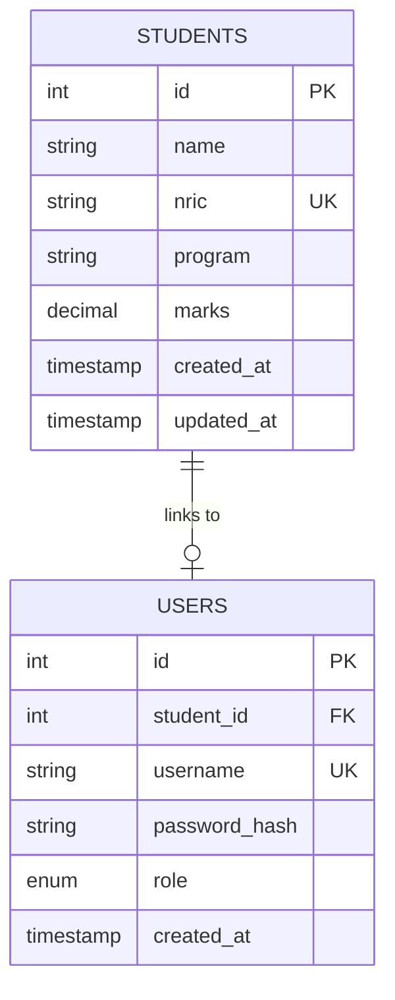

# TECHNICAL DOCUMENTATION REPORT
## PSP Student Portal — Mini Project 1 (DFP40443)
**Course Code**: DFP40443 Full Stack Web Development  
**Session**: Sesi I 2025/2026 / 2026/2027  
**Department**: Jabatan Teknologi Maklumat dan Komunikasi, Politeknik Malaysia  

---

## 1. Introduction
The **PSP Student Portal** is a web-based database application developed for Politeknik Seberang Perai (PSP) students and administrators. Designed in accordance with software engineering standards, the system implements the Model-View-Controller (MVC) architectural pattern, secure session-based authentication, bcrypt password hashing, dynamic MySQL database integration, and parameterized SQL security.

The portal provides two core operational modules:
1. **Profile Management & Account Security**: Allows students to view their personal profile information (Name, NRIC, Program, Marks) bound strictly to their authenticated session, while enabling secure password updates via the Password Exchange Module.
2. **Grade Management System Revamp (Student CRUD)**: Provides administrators with real-time Create, Read, Update, and Delete (CRUD) capabilities directly synchronized with MySQL.

---

## 2. System Requirements
### Hardware & Software Environment
- **Operating System**: Windows / Linux / macOS
- **Web Server**: Apache HTTP Server (via XAMPP v3.3+)
- **Database Engine**: MySQL / MariaDB (InnoDB Engine, utf8mb4)
- **Programming Language**: PHP 8.1+ (with PDO extension enabled)
- **Front-End Framework**: Bootstrap 5.3.3 (via CDN)
- **Base URL Endpoint**: `/PSP_Student_Portal_MiniProject1/public`

---

## 3. MVC Architecture
The system follows a strict Model-View-Controller (MVC) design pattern to separate business logic, database interaction, and user interface presentation:

- **Model Layer (`models/`)**: Encapsulates all SQL query execution and database interactions using PDO prepared statements. Contains zero HTML presentation logic.
  - `AuthModel.php`: Handles user lookup, session resolution, and password updates.
  - `StudentModel.php`: Handles student record querying, insertion, modification, and deletion.
- **View Layer (`views/`)**: Rendered HTML presentation components enhanced with Bootstrap 5 CDN styling. Contains zero SQL queries.
  - `auth/login.php`, `dashboard.php`, `profile/index.php`, `profile/password.php`, `students/index.php`, `students/create.php`, `students/edit.php`, `layouts/header.php`, `layouts/footer.php`.
- **Controller Layer (`controllers/`)**: Intercepts HTTP requests, coordinates validation, interacts with models, and dispatches data to views.
  - `AuthController.php`: Handles authentication, logout, and password change logic.
  - `ProfileController.php`: Manages session-bound profile retrieval.
  - `StudentController.php`: Coordinates admin authorization and student CRUD operations.

```
+-----------------------------------------------------------------------+
|                              CLIENT (BROWSER)                         |
+-----------------------------------------------------------------------+
                                   | HTTP Request
                                   v
+-----------------------------------------------------------------------+
|                    FRONT CONTROLLER (public/index.php)                |
+-----------------------------------------------------------------------+
                                   | Route Action
                                   v
+-----------------------------------------------------------------------+
|                         CONTROLLER LAYER                              |
|   (AuthController.php, ProfileController.php, StudentController.php)  |
+-----------------------------------------------------------------------+
            |                              ^                |
            | Invokes SQL                  | Data           | Renders View
            v                              | Returned       v
+------------------------+      +---------------------------------------+
|      MODEL LAYER       |      |              VIEW LAYER               |
| AuthModel / StudentModel |    |  (Bootstrap 5 HTML/PHP Views & Forms) |
+------------------------+      +---------------------------------------+
            |                              ^
            | PDO Prepared Statement       | Results
            v                              |
+-----------------------------------------------------------------------+
|                           MYSQL DATABASE                              |
|                         (psp_student_portal)                          |
+-----------------------------------------------------------------------+
```

---

## 4. MVC Folder Structure
```
PSP_Student_Portal_MiniProject1/
├── config/
│   ├── config.php          # Session start & BASE_URL definition
│   ├── database.php        # PDO database connection & error options
│   ├── auth.php            # Session guards (requireLogin, requireAdmin, requireStudent) & XSS sanitizer
│   └── csrf.php            # Anti-CSRF token generator & validator
├── controllers/
│   ├── AuthController.php   # Login, logout & password exchange flow
│   ├── ProfileController.php# Session-bound profile management
│   └── StudentController.php# Authorization & Student CRUD handlers
├── models/
│   ├── AuthModel.php       # Prepared SQL queries for users & login
│   └── StudentModel.php    # Prepared SQL queries for student CRUD
├── views/
│   ├── auth/
│   │   └── login.php       # User login interface
│   ├── profile/
│   │   ├── index.php       # Profile display interface
│   │   └── password.php    # Password change interface
│   ├── students/
│   │   ├── index.php       # Student CRUD table (READ)
│   │   ├── create.php      # Student addition form (CREATE)
│   │   └── edit.php        # Student modification form (UPDATE)
│   ├── layouts/
│   │   ├── header.php      # Reusable navigation header
│   │   └── footer.php      # Reusable page footer
│   └── dashboard.php       # Main role dashboard
├── public/
│   ├── index.php           # Front Controller / Router
│   ├── css/style.css       # Custom stylesheet
│   └── js/main.js          # Client validation & JS confirmation dialogs
├── database/
│   └── psp_student_portal.sql # Official MySQL schema & seed export
└── docs/
    ├── README.md           # Setup guide & project summary
    └── REPORT_CONTENT.md   # Technical documentation report
```

---

## 5. System Flow
1. **User Request**: User accesses `public/index.php?action=<action>`.
2. **Authentication Guard**: `public/index.php` loads configuration, starts PHP session, and checks requested action against access control rules.
3. **Controller Execution**: The matching Controller method processes input parameters and verifies CSRF tokens for POST requests.
4. **Model Execution**: Controller delegates database operations to the Model, which executes parameterized SQL queries against MySQL.
5. **View Rendering**: Controller injects retrieved data into the corresponding View file, which renders clean Bootstrap 5 HTML to the client browser.

---

## 6. Database Design
The relational database `psp_student_portal` consists of two normalized tables linked by foreign key constraints:

### `students` Table Schema
- `id` (INT UNSIGNED, AUTO_INCREMENT, PRIMARY KEY): Unique student record ID.
- `name` (VARCHAR(100), NOT NULL): Full student name.
- `nric` (VARCHAR(20), NOT NULL, UNIQUE): National Registration Identity Card number.
- `program` (VARCHAR(150), NOT NULL): Enrolled academic diploma program.
- `marks` (DECIMAL(5,2), NOT NULL, DEFAULT 0.00): Academic score (0.00 - 100.00).
- `created_at` (TIMESTAMP, DEFAULT CURRENT_TIMESTAMP): Record creation timestamp.
- `updated_at` (TIMESTAMP, DEFAULT CURRENT_TIMESTAMP ON UPDATE CURRENT_TIMESTAMP): Last update timestamp.
- **Constraint**: `chk_marks CHECK (marks >= 0.00 AND marks <= 100.00)`

### `users` Table Schema
- `id` (INT UNSIGNED, AUTO_INCREMENT, PRIMARY KEY): Unique user account ID.
- `student_id` (INT UNSIGNED, NULL, UNIQUE): Foreign key referencing `students.id`.
- `username` (VARCHAR(50), NOT NULL, UNIQUE): Login identifier (NRIC or admin username).
- `password_hash` (VARCHAR(255), NOT NULL): Securely hashed password string (bcrypt).
- `role` (ENUM('student','admin'), NOT NULL): User authorization role.
- `created_at` (TIMESTAMP, DEFAULT CURRENT_TIMESTAMP): Account creation timestamp.
- **Foreign Key**: `CONSTRAINT fk_users_student FOREIGN KEY (student_id) REFERENCES students(id) ON UPDATE CASCADE ON DELETE SET NULL`

---

## 7. Entity Relationship Diagram (ERD)



---

## 8. Part 1 — Student Profile Management
The Student Profile page (`views/profile/index.php`) displays the student's Name, NRIC, Program, and Marks. The authenticated `$_SESSION['user_id']` identifies the logged-in user, and the Model retrieves the corresponding student data from MySQL. The controller explicitly ignores any URL parameter (e.g. `$_GET['id']` or `$_POST['student_id']`), preventing unauthorized access to other students' profiles.

---

## 9. Session Management
Upon successful credential validation:
1. `session_regenerate_id(true)` is invoked to prevent session fixation attacks.
2. `$_SESSION['user_id']` and `$_SESSION['role']` are stored in server memory.
3. Protected pages verify active sessions via `requireLogin()` / `requireStudent()` / `requireAdmin()` before rendering content.
4. Logging out invokes `session_destroy()`, clears session arrays, and deletes session cookies.

---

## 10. Access Control & Authorization
The portal enforces strict Role-Based Access Control (RBAC):
- **Student Role**: Access restricted to Dashboard, My Profile, and Change Password. Attempts to access `action=students` trigger `requireAdmin()`, returning HTTP 403 Forbidden.
- **Admin Role**: Access to Dashboard and Student Grade CRUD operations (`action=students`, `action=student_create`, `action=student_edit`, `action=student_delete`). Student Profile feature is restricted to student accounts via `requireStudent()`.

---

## 11. Password Exchange Module & Security
Located at `action=password`, this module handles password updates securely:
1. **Old Password Verification**: Checks submitted password against stored database hash using `password_verify($oldPassword, $user['password_hash'])`.
2. **Validation**: Validates that new password has minimum 8 characters and matches confirmation password.
3. **Bcrypt Hashing**: Encrypts new password using `password_hash($newPassword, PASSWORD_DEFAULT)` before executing SQL UPDATE. No plain text passwords are ever stored.

---

## 12. Part 2 — Dynamic MySQL Integration
Student data is retrieved dynamically from MySQL via `StudentModel.php`. Hard-coded arrays are strictly eliminated. All data displayed in the portal reflects real-time database state.

---

## 13. CREATE Operation
- **Form Interface**: `views/students/create.php` contains fields for Full Name, IC/NRIC, Program, and Marks.
- **Process**: Validates inputs, then invokes `StudentModel::create()`, which executes an `INSERT INTO students` query via prepared statements.

---

## 14. READ Operation
- **Table Interface**: `views/students/index.php` queries all student records via `StudentModel::all()`.
- **Display**: Presents records in a responsive Bootstrap table with score badges.

---

## 15. UPDATE Operation
- **Form Interface**: `views/students/edit.php` pre-fills existing student details.
- **Process**: Validates inputs, then executes `StudentModel::update()`, updating database records dynamically.

---

## 16. DELETE Operation
- **Confirmation Prompt**: Before submission, JavaScript executes `window.confirm('Are you sure you want to permanently delete this student record? This action cannot be undone.')`. If canceled, form submission is halted and record remains in MySQL.
- **Process**: Upon confirmation, POST form submits `id` and `csrf_token` to `action=student_delete`, executing `StudentModel::delete()`.

---

## 17. SQL Security & Prepared Statements
All database operations utilize PDO Prepared Statements with named parameter binding. User input is never concatenated directly into SQL strings, neutralizing SQL Injection threats.

```php
// Example: Prepared Statement in AuthModel.php
$stmt = $this->pdo->prepare(
    "SELECT u.id AS user_id, u.student_id, u.username, u.password_hash, u.role,
            s.name, s.nric, s.program, s.marks
     FROM users u
     LEFT JOIN students s ON s.id = u.student_id
     WHERE u.username = :username LIMIT 1"
);
$stmt->execute(['username' => $username]);
```

---

## 18. Client-Side Validation
Form elements utilize HTML5 attributes (`required`, `minlength="2"`, `maxlength="50"`, `min="0"`, `max="100"`, `step="0.01"`). Custom JavaScript (`public/js/main.js`) enables Bootstrap `.was-validated` feedback and enforces real-time password matching.

---

## 19. Server-Side Validation
Controller methods perform secondary validation using PHP logic before database invocation:
- Verifies non-empty input strings.
- Enforces numeric range checks (`marks >= 0.00` and `marks <= 100.00`).
- Validates password complexity and match conditions.
- Catches duplicate NRIC PDO exceptions gracefully.

---

## 20. Comprehensive Testing Plan
- **PHP Syntax Check**: Ran `php -l` on all PHP files (0 syntax errors).
- **Database Import Test**: Verified SQL import execution and table structure creation.
- **Password Hash Verification Test**: Tested `password_verify()` against demo student and admin credentials.
- **Session Access Control Test**: Verified student ID manipulation in profile URL is ignored.
- **CRUD Functional Test**: Verified CREATE, READ, UPDATE, and DELETE operations.

---

## 21. Strategic Screenshot Evidence Plan

The implementation satisfies all requirements specified in the question paper and rubric. Screenshot evidence should be captured and inserted into the corresponding sections below:

| Screenshot # | Title | Exact URL / Page | Exact action | What must be visible | Requirement demonstrated | Rubric category |
| :--- | :--- | :--- | :--- | :--- | :--- | :--- |
| **1** | Login Page | `public/index.php?action=login` | Open login URL | Username & Password fields, Login button, Bootstrap styling, Demo credential callout box | Form fields, buttons & styling | Bootstrap / UI Quality |
| **2** | Student Dashboard | `action=dashboard` | Log in as `010101-01-0101` | Welcome message, student role badge, action cards | Session login & dashboard | Session & Profile |
| **3** | Student Profile | `action=profile` | Click "My Profile" | Student Name, NRIC, Program, Marks retrieved via session | Session-based profile retrieval | Session & Profile (Q1) |
| **4** | Profile URL Manipulation | `action=profile&id=2` | Append `?id=2` to profile URL | Profile STILL displays `010101-01-0101` logged-in data | Ignore URL student ID params | Session Access Control |
| **5** | Password Change Form | `action=password` | Click "Change Password" | Old Password, New Password, and Confirm Password fields | Password update form interface | Password Security (Q1) |
| **6** | Wrong Old Password Alert | `action=password` | Submit incorrect old password | Red error alert: "Old password is incorrect" | Server-side old password validation | Password Security |
| **7** | Password Mismatch Alert | `action=password` | Submit mismatched new passwords | Feedback message: "Passwords do not match" | Client/Server mismatch validation | Password Security |
| **8** | Successful Password Change | `action=password` | Submit valid password update | Green success alert: "Password updated successfully" | Password update execution | Password Security |
| **9** | phpMyAdmin Password Hash | phpMyAdmin -> `users` table | Inspect database rows | Hashed string starting with `$2y$10$` in `password_hash` column | Password hashing storage | Password Hashing |
| **10** | Admin Dashboard | `action=dashboard` | Log in as `admin` / `Admin@123` | Admin dashboard with link to Student Grade CRUD System | Role-based admin access | Access Control |
| **11** | CRUD READ Table | `action=students` | Click "Student CRUD" | Table displaying all dynamic student records from MySQL | Dynamic MySQL READ table | Database & CRUD (READ) |
| **12** | CREATE Form | `action=student_create` | Click "+ Add Student" | Input fields for Name, IC, Program, Marks | Student record creation form | Database & CRUD (CREATE) |
| **13** | Created Record | `action=students` | Submit valid CREATE form | New student row visible in READ table + success message | Database INSERT execution | Database & CRUD |
| **14** | UPDATE Form & Result | `action=student_edit&id=X` | Click "Edit" & save updated values | Pre-filled edit form & updated values reflected in READ table | Database UPDATE execution | Database & CRUD (UPDATE) |
| **15** | DELETE Confirmation Dialog | `action=students` | Click "Delete" button | JavaScript confirmation dialog window: "Are you sure..." | Confirmation prompt before delete | Database & CRUD (DELETE) |
| **16** | Deleted Record Result | `action=students` | Confirm deletion dialog | Record permanently removed from READ table & MySQL | Database DELETE execution | Database & CRUD |
| **17** | Student Denied Admin CRUD | `action=students` (as Student) | Attempt to open CRUD URL as student | HTTP 403 Forbidden error response | Role access protection | Access Control |
| **18** | Architecture & SQL Security Evidence | Code Editor / phpMyAdmin | Open `StudentModel.php` & ERD | Clean MVC folders, PDO `$pdo->prepare()`, FK constraints | MVC structure, SQL security & ERD | MVC, SQL Security & ERD |

---

## 22. Conclusion
The **PSP Student Portal** implementation satisfies all structural, formal, and security requirements laid out in the Mini Project 1 question paper and rubric. Through strict MVC separation, session-bound security, bcrypt password hashing, dynamic MySQL integration, prepared statements, dual validation, and responsive Bootstrap UI, the project serves as a clean, complete full-stack web application suitable for academic evaluation.
